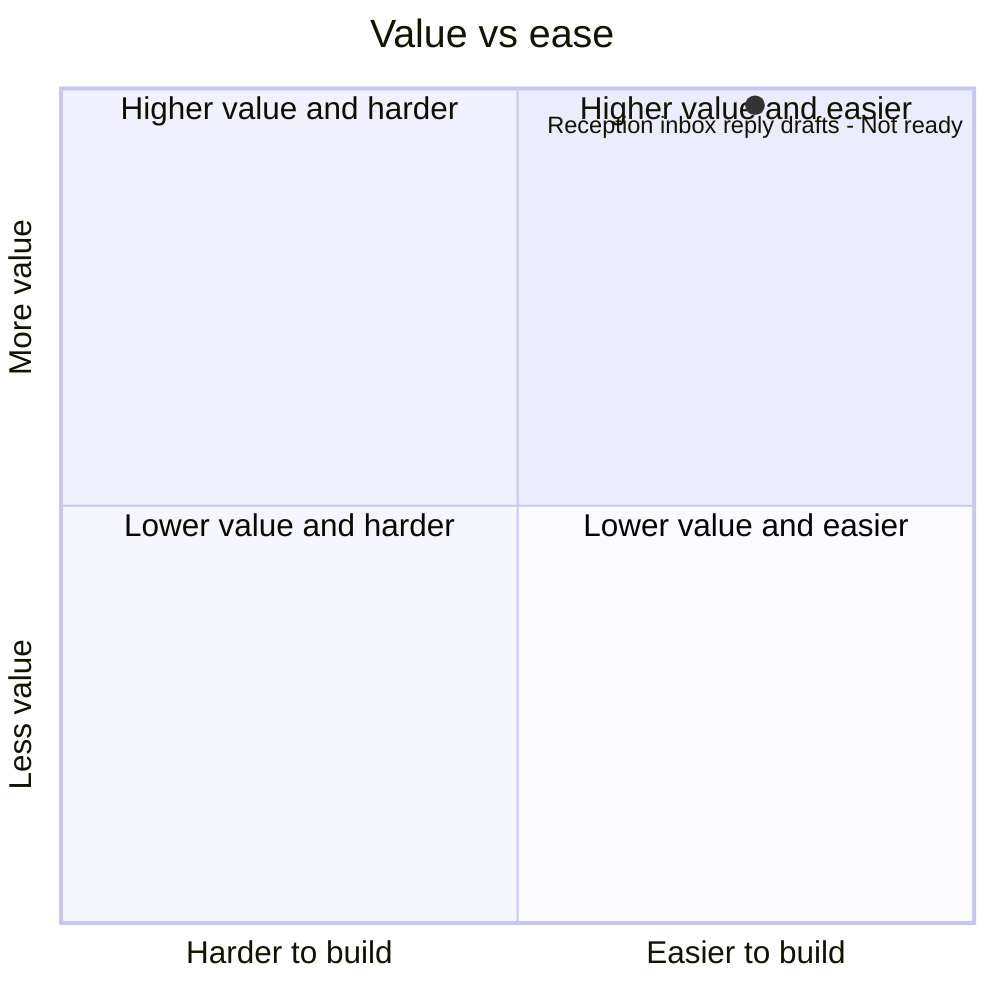
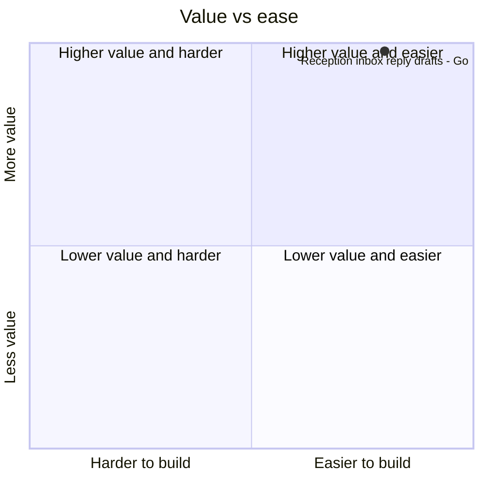
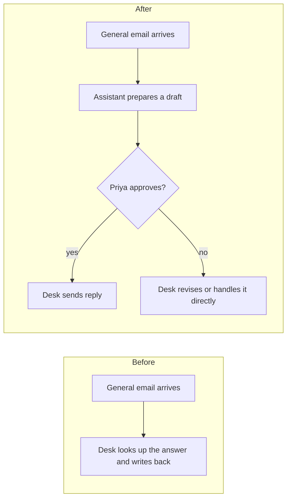

# Roleplay test of v0.2 (Codex GPT-6.2-Sol, 2026-11-22)

Codex played both the agent (following the Skill exactly) and two simulated owners. Script outputs are from real local runs; businesses, CSV and quote are simulated.


Dana gets a useful Jobber fix and leaves without booking. Priya gets a defensible draft-only pilot, but the script switches to Go as soon as it sees an export that cannot resolve the staff time disagreement. Both hear their first practical suggestion only after most of the intake.

I played both sides using the workspace Skill v0.2. The business details, staff notes, quote and CSV are simulated. The script outputs are from actual local runs. For the loaded hourly cost, I used each owner's rough wage and dollar estimate for overhead. Dana had no usable revenue estimate, so her valuation uses labour only. I added an existing draft-only quote to Priya's scenario to test the quoted path. Her staff estimates appear as a note she reads back from a separate check with the desk.

I counted each Agent turn once, including the final report. Each turn with a question counts once, including evidence requests phrased as questions. "First useful" means the first practical suggestion or decision specific to the business. I excluded acknowledgments, summaries and the internal script runs from that threshold.

| Session | Agent messages / questions before first useful advice | First useful advice | Total agent messages / questions |
|---|---:|---|---:|
| Dana | 25 / 25 | Message 26 | 37 / 36 |
| Priya | 23 / 23 | Message 24 | 34 / 33 |

## Dana, plumbing and heating

### Transcript

**Agent:** What kind of work does the company do?

**Owner:** Plumbing and heating. Service calls mostly, some installs. I've got about 20 minutes before my next one.

**Agent:** How many people are on the team?

**Owner:** Seven including me. Sounds bigger than it is when everyone's out in a van.

**Agent:** What do you use to run the office side?

**Owner:** Jobber and Gmail. I pay for ChatGPT Plus. I used it for a Christmas-hours sign and it got the dates wrong.

**Agent:** What does an hour of office time cost you once wages and overhead are included?

**Owner:** No idea. Is that what I take home or what the company pays?

**Agent:** What's the hourly wage for comparable office work?

**Owner:** We paid $27 an hour the last time we had regular admin help.

**Agent:** Roughly how much extra per hour did payroll costs and benefits add?

**Owner:** Call it another nine bucks. That was the ballpark from the bookkeeper. I'm going off memory.

**Agent:** What takes time when a new customer tries to reach you?

**Owner:** Calls go to voicemail when we're out. Sometimes I don't get to them until the end of the day. It's worse the first cold week. The phone rings while I'm trying to hear what a boiler is doing.

**Agent:** Who goes through the missed calls?

**Owner:** Me. The crew tell me about calls from people they know, but they don't work the voicemail list.

**Agent:** About how many missed calls do you work through in a normal week?

**Owner:** A lot. Maybe 18 that I actually work through. There are also numbers that hang up without leaving anything.

**Agent:** How many minutes of work does one take, leaving out the wait for a callback?

**Owner:** Seven-ish? I listen, see if I know the address, and jot down what they need before I call. I'm counting the prep, not the actual call.

**Agent:** How often do you have to do the prep twice?

**Owner:** A couple times a week. I replay a message because I can't make out a unit number over the road noise.

**Agent:** What does that repeat work cost you?

**Owner:** It's already in the seven minutes. I'm not paying somebody twice.

**Agent:** Do you lose jobs when the callback runs late?

**Owner:** Sure. I hear "we found someone" sometimes. And the ones who don't leave anything, who knows.

**Agent:** How much revenue do you think you lose to those missed calls in a year?

**Owner:** Couldn't tell you. An install and a plugged sink are completely different numbers.

**Agent:** What share of a sale is left after you pay to do the work?

**Owner:** Depends on the job. My accountant could tell you something for the whole company. I'm in the van.

**Agent:** About how many hours a week do you spend doing the callback prep?

**Owner:** Two, maybe. If it snows, throw that answer out.

**Agent:** Is there much separate office work when you book or schedule the jobs?

**Owner:** Takes a minute while I'm on the phone. Quotes are a couple quick ones after I've been out. The crew's actual work is the whole business. Any customer questions go to the same phone. There's no separate pile for that stuff.

**Agent:** What takes time with invoicing or getting paid?

**Owner:** Chasing old bills. I have the scheduled reminder turned off in Jobber. I didn't want it going out while somebody was disputing a bill.

**Agent:** Who chases those invoices now?

**Owner:** Me, Friday if I remember.

**Agent:** About how many routine overdue invoices do you chase in a week?

**Owner:** Maybe eight. I'm leaving out the disputed ones.

**Agent:** How many minutes does one reminder take?

**Owner:** Four, by the time I pull up the invoice and find the last email.

**Agent:** How often do you have to redo a reminder?

**Owner:** Hardly ever. Sometimes I realise they've already paid before I hit send. That's part of the four minutes.

**Agent:** Do late reminders cost you sales?

**Owner:** No. People pay later.

**Agent:** How many hours a week does the chasing feel like to you?

**Owner:** Half an hour. Are we getting to the phone part?

**Agent:** Is there another back-office job that takes enough time to include?

**Owner:** My bookkeeper does the books, and the rest is little bits here and there. Can we stick to the phone?

**Agent:** The routine invoice chase can use Jobber's scheduled reminder. Keep disputed bills out of that batch and handle them yourself. The callback notes need someone to make sense of what callers say. What share of those notes could an assistant prepare completely for you to review?

**Owner:** Half, maybe. A normal "my water heater died" message, sure. Some of them sound like they recorded it inside a dryer.

**Agent:** What share of the lost jobs could faster callback notes realistically win back?

**Owner:** How would I know? If I'm up a ladder, a tidier note still sits there. I thought we were talking about picking up the phone.

**Agent:** Which steps would you want to approve, including anything involving money, a commitment or safety?

**Owner:** I make the call. No booking, no "we'll be there in an hour," no prices, no deposits, and definitely no telling someone what to do with a furnace.

**Agent:** Would you want to approve every price or deposit?

**Owner:** Every one. Zero wiggle room.

**Agent:** Could you easily undo everything the assistant would do on its own?

**Owner:** If it's just a note, I can bin it. That's it.

**Agent:** Who would own the job and approve anything that needs a decision?

**Owner:** Still me.

**Agent:** If the drafts were messing up, how would you get back to the old way that day?

**Owner:** Turn the drafts off and work through the same voicemail inbox myself.

**Agent:** Where are the voicemail recordings kept?

**Owner:** Gmail gets the notice. To hear it, you click through and sign into the phone account.

**Agent:** Could the assistant get to the recordings and use them as they are?

**Owner:** No. That's my login. I'm not handing it over.

**Agent:** What would it need to have access to?

**Owner:** The recordings themselves in the shared inbox somehow. And if they hang up, there isn't anything to listen to.

*The agent ran `python ai-opportunity-diagnostic/scripts/diagnose.py dana-input.json --markdown`.*

**Agent:** The callback estimate still rests on your recollection. Can you send about 30 days of call or voicemail records as a CSV so we can check the volume?

**Owner:** No, I don't know where to get that. I'm at the job now. What's the answer?

*The agent ran the same command again after the evidence request. With no export or new facts, the JSON and output stayed identical. The output is shown once, in the report Dana received.*

**Agent:** **Not yet.** Use the scheduled Jobber reminder for routine overdue invoices. Keep the voicemail as it is for now. Callback notes would save some prep, and you'd still need time to call people back.

#### Dana's plumbing and heating company

| Rank | Job | Outcome | Value per year | Net first year | Evidence | Why |
|---|---|---|---|---|---|---|
|  | Missed-call callback notes | Not ready | $1,278 | needs quote | single estimate | quote: pays back if the build plus a year of running costs stays under $1,278; data: The shared Gmail inbox gets voicemail notices, but opening the actual recordings requires Dana's separate phone login. Some callers leave no message. |
|  | Routine overdue invoice reminders | Not AI | – | – | – | Use the scheduled invoice reminder in Jobber for routine overdue invoices and handle disputes by hand. |

Jobs without a quote are not charted.

- **Missed-call callback notes.** The value is based on your estimate of prep time. We couldn't verify volume from records or put a figure on lost jobs. To revisit it, we'd need usable recordings where you want the drafts made and a quote below the script's first-year ceiling, including running costs. Calls without messages need a separate callback process.
- **Routine overdue invoice reminders.** Use the scheduled Jobber reminder for the usual late bills you already chase. Deal with disputed invoices yourself.

Contact agenticworks.ca for a quote once the recordings are accessible. The quote settles whether the draft job pays back.

**Owner:** I'll look at Jobber. I won't book anything right now. I need somebody to answer the phone, and I'd still be the one calling everybody.

### Input used on both runs

```json
{
  "business": "Dana's plumbing and heating company",
  "loaded_hourly_cost": 36,
  "jobs": [
    {
      "id": "missed_call_callback_notes",
      "name": "Missed-call callback notes",
      "done_by": "Dana",
      "weekly_volume": 18,
      "minutes_per_item": 7,
      "hours_claims": {"owner": 2},
      "rule_covers_most": false,
      "share_handled": 0.5,
      "asks_first": ["Any customer contact", "Booking or promising a callout", "Quoting a price or taking a deposit", "Any safety decision"],
      "on_own_is_reversible": true,
      "approver": "Dana",
      "rollback": "Turn off the draft workflow and work through the same voicemail inbox by hand",
      "data_ready": false,
      "data_blocker": "The shared Gmail inbox gets voicemail notices, but opening the actual recordings requires Dana's separate phone login. Some callers leave no message."
    },
    {
      "id": "routine_overdue_invoice_reminders",
      "name": "Routine overdue invoice reminders",
      "done_by": "Dana",
      "weekly_volume": 8,
      "minutes_per_item": 4,
      "hours_claims": {"owner": 0.5},
      "rule_covers_most": true,
      "rule_fix": "Use the scheduled invoice reminder in Jobber for routine overdue invoices and handle disputes by hand."
    }
  ]
}
```

### Critique

- **Where it felt like a form.** “What does an hour of office time cost you once wages and overhead are included?” prompts two more cost questions before Dana has described a missed call. The sequence “How much revenue do you think you lose to those missed calls in a year?” and “What share of a sale is left after you pay to do the work?” arrives just after she says she can't distinguish the jobs she lost. The agent still asks for recapture later. “Are we getting to the phone part?” lands before one final intake question. Then “Who would own the job and approve anything that needs a decision?” gets “Still me.”
- **What stayed on the surface.** The first cold week, the noisy boiler and the hang-ups are better leads than seven minutes of note prep. A consultant would trace a recent caller from ring to resolution, compare callbacks by time of day, ask who has capacity to return calls while Dana is on site, and find out what happens to people who never leave a message. A clear callback promise with someone assigned to check that it happens, or a short test of overflow phone coverage, addresses the problem Dana wants solved. An assistant can pull usable details out of clear messages. A draft can't help a caller who hung up or create time for a callback.
- **What got too much weight.** The annual lost-sales figure, gross margin and recapture share all depend on information Dana lacks. Even if she could supply them, the audio access problem and lack of anyone available to call back would still be there. The routine invoice reminder gets a full time-and-rework interview before the existing Jobber setting can be suggested.
- **Where the instructions made the agent awkward.** The intake tells the agent to ask what explains discrepancies with calculated hours, while the main Skill puts calculation after intake and forbids calculating in prose. Here the agent collected the figures and waited for the script. The script also treats missing lost revenue as zero, so the agent had to explain verbally that the `$1,278` measures labour only. The Skill describes the quote blocker as a maximum build cost. The actual output gives a ceiling for build plus a year of running costs.
- **Recommendation and follow-up.** “Not yet” is right for voicemail-note drafting. The Jobber fix is useful on its own. The report falls short on the problem Dana called about, because the Skill's next step is a quote for a job she sees as beside the point. In the simulation, she declines a follow-up.

## Priya, physiotherapy clinic

### Transcript

**Agent:** What does the clinic do?

**Owner:** Physio. Four practitioners, two people on the front desk and me running the office. I want an AI receptionist that handles everything. One of the desk staff saw an ad for one and now thinks I'm getting rid of her.

**Agent:** What systems does the desk use for its work?

**Owner:** Jane for appointments. Google Workspace for email and shared files. We don't use any AI at the clinic.

**Agent:** What does an hour of front-desk time cost once payroll costs and benefits are included?

**Owner:** I can tell you the hourly wage. I don't run payroll.

**Agent:** What's the hourly wage for the desk?

**Owner:** About $25 for the person who does most of the opening shifts.

**Agent:** Roughly how much extra per hour do payroll costs and benefits add?

**Owner:** Finance told me to budget about $8 on top when I asked for Saturday coverage. That's all I have.

**Agent:** What takes time when a new patient gets in touch?

**Owner:** Phones and the shared inbox happen at the same time. Here's a typical email: “Do you have parking, what should I bring, and can I get a receipt?” The phones are worse around lunch, but I have no idea how many we miss.

**Agent:** Who prepares the written replies to the general inquiries?

**Owner:** The two desk staff. Whoever's looking at the inbox at the time.

**Agent:** How many of those replies do they prepare in a week?

**Owner:** Thirty-five? More in January. Some are a whole thread.

**Agent:** How many minutes does it take to prepare a reply, excluding time waiting to hear back?

**Owner:** Eight minutes to look things up and put a reply in words, before sending. Sometimes they know it off the top of their head.

**Agent:** How often do they have to redo that work?

**Owner:** A few a week. Someone thinks the other person already answered, so they open it again, or they have to change what they drafted.

**Agent:** What does that extra work cost?

**Owner:** Nothing separate. It's in what I just told you.

**Agent:** Do late inbox replies cost the clinic bookings?

**Owner:** I couldn't point to any. People who want a slot tend to call. That ringing is why I'm looking at this.

**Agent:** How many hours a week would you say the desk spends preparing those replies?

**Owner:** Four and a half, about. That's just writing and looking things up.

**Agent:** What takes time with booking or scheduling?

**Owner:** Reminding everybody. We send the booking confirmation, then the desk does the day-before reminders by hand. Jane has a setting for it. We used to have some exceptions and never turned it on.

**Agent:** Who sends the reminders?

**Owner:** The same two people.

**Agent:** How many standard reminders do they send in a week?

**Owner:** Around 45.

**Agent:** How many minutes does each one take?

**Owner:** Two minutes, give or take. It's the same message.

**Agent:** How often do they redo a reminder?

**Owner:** Almost never on the standard ones. We check the schedule first.

**Agent:** Do missed reminders cost the clinic sales?

**Owner:** No missed appointment I can blame on that. We have a waitlist some days.

**Agent:** How much desk time do you think those standard reminders take each week?

**Owner:** Hour and a half, maybe. I can give you the rest Thursday if this is turning into a time study.

**Agent:** Where else does the office work pile up, from estimates and service delivery to patient questions, billing and admin?

**Owner:** We don't do estimates. Practitioners do their own treatment and notes. General questions are that same inbox and phone. The desk just does the routine payments when people leave, and I do the monthly paperwork. I called about reception because of the interruptions.

**Agent:** What weekly total did the desk give you separately for preparing inbox replies?

**Owner:** I asked before we spoke. Their note says “eight hours with everything that comes in while we're on inbox.” One of them asked if I was timing her. Can we leave her name out of it?

**Agent:** What weekly total did the desk give you for the standard reminders?

**Owner:** Hour and a half as well. Those are pretty easy to count.

**Agent:** Turn on the day-before reminder in Jane for standard appointments and let the desk handle exceptions. The inbox questions vary enough that a fixed reminder-style rule won't cover the replies. What share of those inbox replies could an assistant fully draft for the desk to review?

**Owner:** Six in ten if it's hours, parking, what to bring, that sort of thing. When somebody starts describing their back pain it gets more complicated. Would it answer the phone too?

**Agent:** Which steps would you want someone to approve, including sending a message, making a booking promise, handling money or making a safety decision?

**Owner:** It can make drafts. I want an actual person sending them. No appointment changes or promises, no special prices or refunds, no deciding who's urgent. For the phone I thought it would just book everybody, but I don't want it promising things we can't do.

**Agent:** Should every price exception, charge or refund require approval?

**Owner:** Yes, every time. It doesn't touch the money. We already have a way we do that.

**Agent:** Could you easily undo everything it would do by itself?

**Owner:** A draft? Sure. Delete it.

**Agent:** Who would be the one person to own this and approve those decisions?

**Owner:** Me. The desk can show me a draft and I can sign off while we try it.

**Agent:** How would you switch back to the old way that day if it went wrong?

**Owner:** Turn off the drafts. The girls still have the inbox, so they can go back to writing the replies.

**Agent:** Where are the inquiries and the answers the desk refers to?

**Owner:** The actual emails are in the shared Gmail inbox. Our hours, parking and first-visit wording are in a clinic info sheet in Drive. Receipt instructions are in there too. The desk has a separate tally sheet if you need counts.

**Agent:** Could the draft helper use those emails and the clinic info sheet as they are?

**Owner:** Yes. Those two are up to date and they can be used for the drafts. Leave Jane and all the practitioner notes out of it. I did get an estimate last week from someone specifically for drafts. I can forward it.

*The simulated implementer's written quote specifies `build_cost: 750` and `monthly_run_cost: 40` for the inbox draft workflow. The agent used the quote as the cost source and ran `python ai-opportunity-diagnostic/scripts/diagnose.py priya-initial.json --markdown`.*

#### Priya's physiotherapy clinic

| Rank | Job | Outcome | Value per year | Net first year | Evidence | Why |
|---|---|---|---|---|---|---|
|  | Reception inbox reply drafts | Not ready | $3,123 | $1,893 | conflicting | hours: owner says 4.5 a week, staff say 8; settle it with real records |
|  | Routine appointment reminders | Not AI | – | – | – | Turn on the day-before reminder in Jane for standard appointments and have the desk handle exceptions. |



**Agent:** The desk put inbox work at eight hours and you put drafting at four and a half. What does their figure include?

**Owner:** Picking up the phone, people walking in, getting back into an email after interruption. Their note says “while we're on inbox.” I was counting the time actually writing the reply. I can't pull those apart from the note.

**Agent:** Can you send about 30 days of inbox records as a CSV, with any time information the desk captured?

**Owner:** Yes, I can send last month's sheet. It has one row per inquiry thread and some missing topic tags. There's no timer in it. That's all I can send today.

*The agent ran `python ai-opportunity-diagnostic/scripts/profile_csv.py priya-inbox-tally.csv --date received_at`.*

```json
{
  "rows": 120,
  "first_date": "2026-10-01",
  "last_date": "2026-10-30",
  "days_covered": 30,
  "unreadable_dates": 0,
  "weekly_volume": 28.0,
  "blank_share": {
    "received_at": 0.0,
    "thread_id": 0.0,
    "topic": 0.25
  }
}
```

*The agent copied `weekly_volume: 28.0` into the inbox job and set `evidence: "export"`. It left `data_ready` at true because the drafts use the original email and the clinic's reference sheet. The blank `topic` cells are in the tally used to count threads. It ran `python ai-opportunity-diagnostic/scripts/diagnose.py priya-input.json --markdown` and used that output in the report below.*

**Agent:** Start with a trial of drafts for routine inbox replies. Switch on the standard appointment reminder separately. Keep the existing phone coverage while you see whether drafts save the desk any time.

#### Priya's physiotherapy clinic

| Rank | Job | Outcome | Value per year | Net first year | Evidence | Why |
|---|---|---|---|---|---|---|
| 1 | Reception inbox reply drafts | Go | $3,844 | $2,614 | export | clears every gate |
|  | Routine appointment reminders | Not AI | – | – | – | Turn on the day-before reminder in Jane for standard appointments and have the desk handle exceptions. |



- **Reception inbox reply drafts.** The tally gives us a count of inquiries. Drafting time and the share it can handle are still estimates.
- **Routine appointment reminders.** Use Jane's day-before reminder for standard bookings. Have the desk handle the exceptions.

#### Inbox draft trial

- **Handles on its own.** Drafts replies about clinic hours, parking, first-visit instructions and routine receipt questions using the clinic info sheet.
- **Asks first.** Sending any reply. Making or promising any appointment change. Any price exception, charge or refund. Any symptom or urgency decision.
- **Never.** Takes live calls, accesses practitioner notes or makes changes in Jane. Symptom and urgency questions go to a person.
- **Approver.** Priya.
- **How to switch back.** Turn off drafting. The desk resumes writing replies in the same inbox.
- **Value.** The script projects `$2,614` net in the first year using the inbox tally, the prep estimates and the written quote.
- **Case against.** Drafting might move time from writing to checking, while the ringing phone keeps interrupting the desk. I would still try it because it leaves the desk in charge of the reply and lets the team test whether it actually saves time on the routine messages.
- **When to stop.** On day 30, stop if writing and reviewing replies still takes the desk as long as before, or if drafts regularly need rewriting to correct basic clinic information.



#### 90 days

| When | What | Done when |
|---|---|---|
| Days 1 to 30 | Try drafts for routine inbox replies. Use the existing reminder setting for standard appointments. | Priya and the desk check prep and review time and how often they have to rewrite drafts. |
| Days 31 to 60 | If the trial saved time, keep drafts in use and fix clinic wording that caused repeat edits. | The desk can review drafts while keeping up its existing phone coverage. |
| Days 61 to 90 | Review the inbox results with the desk and decide whether to keep paying for it. | Priya and the desk have enough experience to decide whether it's saving them work. |

#### What would change the answer

If checking drafts takes as long as writing the replies, go back to manual replies. Keep track of missed calls separately before deciding what kind of phone coverage the clinic needs.

Contact agenticworks.ca to have the inbox draft trial set up and run with you.

**Owner:** I'd book a short call if both desk staff can be there. I want to tell them first what this handles and ask them if it would help. I'm still going to need an answer on the phones.

### Input before the evidence pass

```json
{
  "business": "Priya's physiotherapy clinic",
  "loaded_hourly_cost": 33,
  "jobs": [
    {
      "id": "inbox_reply_drafts",
      "name": "Reception inbox reply drafts",
      "done_by": "Front-desk staff",
      "weekly_volume": 35,
      "minutes_per_item": 8,
      "hours_claims": {"owner": 4.5, "staff": 8},
      "rule_covers_most": false,
      "share_handled": 0.6,
      "asks_first": ["Sending any reply", "Making or promising any appointment change", "Any price exception, charge or refund", "Any symptom or urgency decision"],
      "on_own_is_reversible": true,
      "approver": "Priya, office manager",
      "rollback": "Turn off drafting and have the desk resume writing replies in the same inbox",
      "data_ready": true,
      "build_cost": 750,
      "monthly_run_cost": 40
    },
    {
      "id": "appointment_reminders",
      "name": "Routine appointment reminders",
      "done_by": "Front-desk staff",
      "weekly_volume": 45,
      "minutes_per_item": 2,
      "hours_claims": {"owner": 1.5, "staff": 1.5},
      "rule_covers_most": true,
      "rule_fix": "Turn on the day-before reminder in Jane for standard appointments and have the desk handle exceptions."
    }
  ]
}
```

### Input after the evidence pass

```json
{
  "business": "Priya's physiotherapy clinic",
  "loaded_hourly_cost": 33,
  "jobs": [
    {
      "id": "inbox_reply_drafts",
      "name": "Reception inbox reply drafts",
      "done_by": "Front-desk staff",
      "weekly_volume": 28.0,
      "minutes_per_item": 8,
      "hours_claims": {
        "owner": 4.5,
        "staff": 8
      },
      "rule_covers_most": false,
      "share_handled": 0.6,
      "asks_first": [
        "Sending any reply",
        "Making or promising any appointment change",
        "Any price exception, charge or refund",
        "Any symptom or urgency decision"
      ],
      "on_own_is_reversible": true,
      "approver": "Priya, office manager",
      "rollback": "Turn off drafting and have the desk resume writing replies in the same inbox",
      "data_ready": true,
      "build_cost": 750,
      "monthly_run_cost": 40,
      "evidence": "export"
    },
    {
      "id": "appointment_reminders",
      "name": "Routine appointment reminders",
      "done_by": "Front-desk staff",
      "weekly_volume": 45,
      "minutes_per_item": 2,
      "hours_claims": {
        "owner": 1.5,
        "staff": 1.5
      },
      "rule_covers_most": true,
      "rule_fix": "Turn on the day-before reminder in Jane for standard appointments and have the desk handle exceptions."
    }
  ]
}
```

### Critique

- **Where it felt like a form.** Priya leads with staff fear and says she wants the receptionist to “handle everything.” The agent continues with systems and payroll, and follows the complaint about ringing phones into “How many of those replies do they prepare in a week?” By the reminder workload question, Priya says, “I can give you the rest Thursday if this is turning into a time study.” The standalone question about every refund comes after she has already said the assistant can make drafts and a person handles money.
- **What stayed on the surface.** “One of them asked if I was timing her” deserved a conversation. A consultant would ask how the desk sees the job, what Priya intends to do with time saved and where staff want help. Walk through a lunch-hour call and an email that mixes an admin question with symptoms to see where a better callback routine or a small staffing change helps. Drafting from a known clinic policy is a good fit. Live calls require real-time handoffs when someone describes symptoms or needs a schedule exception. The interview never gets into those differences. Priya keeps bringing up the phone and ends up with an email trial.
- **What got too much weight.** Weekly volume, minutes per reminder, rework and two weekly hours estimates do little to change the recommendation to try the existing Jane setting. The nominal `$2,614` net also reads as more certain than the source material warrants. The CSV verifies 28 inquiry threads per week. It has no duration or review-time data and cannot establish that 60% of draft prep goes away. The chart calls this a build-ease comparison even though the position comes from quoted build cost relative to modeled value.
- **Where the instructions made the agent awkward.** Stage 4 calls for an export to settle the hours gap and says to set `evidence: "export"` after profiling. In `diagnose.py`, that label bypasses the hours comparison and applies the highest evidence weight to the whole valuation. The run moved from `$3,123` to `$3,844` in annual value even as weekly volume dropped from an estimate of 35 to an export count of 28. The desk and Priya counted different work, and the re-score leaves that difference unexplained. “Fully handle, the way a capable new hire would” is also ambiguous when staff still have to review drafts. I used Priya's estimate for reply preparation and raised the cost of review in the case against.
- **Recommendation and follow-up.** The day-before reminder is the strongest immediate fix. The draft-only trial is reasonable if the staff see value in it and checks show it saves time. The Go label overstates the evidence, and the recommendation leaves the lunchtime phone problem open. In the simulation, Priya would book a short follow-up with her desk staff present.

## The 5 changes that would most improve it

1. **Move the first useful suggestion up.** In `SKILL.md` and `references/interview.md`, walk through one recent example and give the no-AI fix when it is evident. Do the detailed intake on the best candidate afterwards. Dana and Priya supplied their own reminder settings long before the agent could recommend using them.
2. **Replace the seven-area march with a focused walkthrough.** In `references/interview.md`, ask what happened the last time the problem came up, what the customer experienced and where staff lost time. Follow the pain the person named. That would get Dana to hang-ups and callback capacity, and Priya to lunchtime coverage and why the desk is worried, while each was still engaged.
3. **Define the job in owner language before asking for a share.** In `references/interview.md` and `references/gates.md`, ask “What can it finish without you, and where do you take over?” Only ask about a money limit if money is in scope. Dana can discard a callback note. Priya's staff still own review and sending. Both exchanges could take fewer turns.
4. **Let the verdict state what the team can support today.** In `references/interview.md`, `scripts/diagnose.py` and `references/report.md`, keep a labour-only result when lost revenue is unknown, label it in the output and defer margin and recapture until someone can put a figure on the loss. Describe the quote ceiling as total first-year cost. Dana gets a usable decision without trying to do her accountant's job from a van.
5. **Give the CSV credit for what it measures.** In `SKILL.md` and `scripts/diagnose.py`, retain the owner/staff hours finding when an export only counts items. Keep the estimated time and handled share visible in `references/report.md`. Priya's tally should improve confidence in volume while leaving the draft-time question open.
