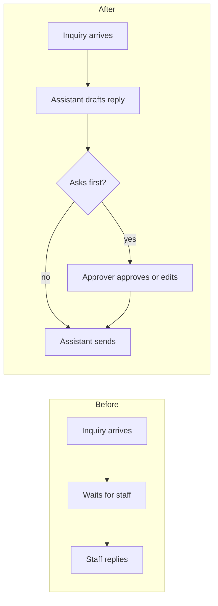

# Report template

Plain words for an owner. Numbers come from the script output, quoted as given.

## 1. The answer

One or two sentences: get an assistant now for job X, or not yet and why.

## 2. All jobs

Paste the script's table and quadrant chart. Add one line per job in owner words: what you found and why it landed where it did. For **Not AI** jobs, name the fix they can set up without us.

## 3. The recommended job

If the answer is "not yet", skip sections 3 and 4. Otherwise, for the top Go job (or two, if both are clearly worth it):

- **Handles on its own:** the specific tasks.
- **Asks first:** each action that needs approval before it runs (for example, any refund, payment, discount, or binding quote).
- **Owner limits:** each action the owner lets run on its own up to a set amount, written as "on its own up to $X, asks above that". Leave out if there are none.
- **Never:** anything it must not touch.
- **Approver:** one named person or role.
- **Rollback:** how to switch back the same day.
- **Value:** the script's net first-year value and the evidence it rests on.
- **Case against:** the strongest reason not to do it, and why it doesn't win.
- **Kill criteria for day 30:** two or three measurable conditions that end the pilot (for example, "fewer than N of the predicted weekly items handled without escalation").

Then a before/after flow:

## 4. 90 days

| When | What | Done when |
|---|---|---|
| Days 1–30 | Pilot the recommended job | Day-30 kill criteria checked |
| Days 31–60 | … | … |
| Days 61–90 | … | … |

## 5. What would change the answer

For each Not ready job, each blocker and what clears it.
