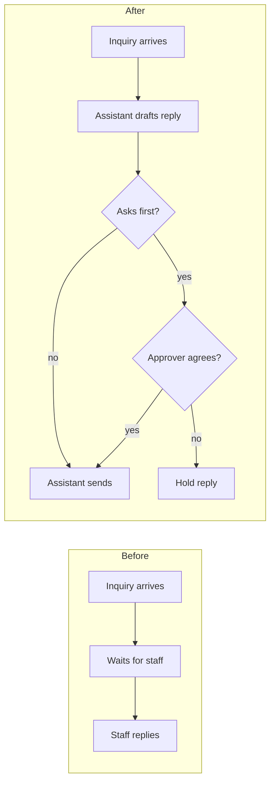

# Report template

Plain words for an owner. Numbers come from the script output, quoted as given.

## 1. The answer

Name the job to start with, or say "not yet" and why. If the case against a higher-ranked job won, give that reason here, even if you recommend another job.

## 2. All jobs

Paste the script's table and quadrant chart. Add one line per job in owner words: what you found and why it landed where it did. For **Not AI** jobs, name the fix they can set up without us.

## 3. The recommended job

If the answer is "not yet", skip sections 3 and 4. Otherwise describe the Go job you recommend.

- **Handles on its own:** the specific tasks.
- **Asks first:** copy the agreed actions from `asks_first`, including any amounts that need approval.
- **Owner limits:** for each entry in `owner_limits`, name the action and say "on its own up to and including $X, asks above that". Leave this out if there are none.
- **Never:** anything it must not touch.
- **Approver:** one named person or role.
- **How to switch back:** what the team would do the same day.
- **Value:** the script's net first-year value and the evidence it rests on.
- **Case against:** the strongest reason not to do it, and why it doesn't win.
- **When to stop the pilot:** two or three things the owner can check on day 30. For example, agree how many items a week the assistant should finish without help.

Then a before/after flow:

## 4. 90 days

| When | What | Done when |
|---|---|---|
| Days 1–30 | Try the recommended job | Owner checks the results and decides whether to continue |
| Days 31–60 | … | … |
| Days 61–90 | … | … |

## 5. What would change the answer

For each Not ready job, list each blocker and what would clear it. If you recommend waiting for another reason, say what would make it worth taking another look.
