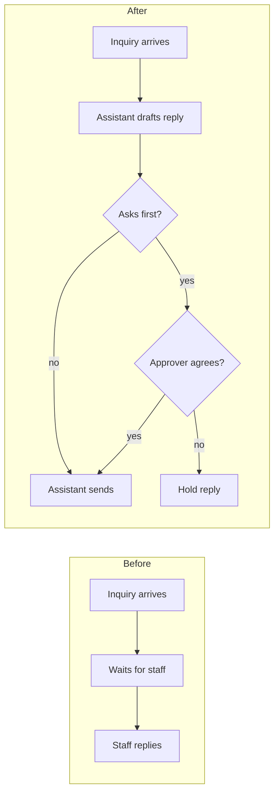

# Report template

Plain words for an owner. Numbers come from the script output, quoted as given.

Fit the length to the conversation. If the answer is a no-AI fix or "not yet", sections 1, 2, 5 and 6 are enough, and a few lines each is fine.

## 1. The answer

Answer the problem the owner came with, in their words. Name the job to start with, the no-AI fix, or "not yet", and why. If what they asked for isn't the right move, say so plainly and say what would be. If the case against a higher-ranked job won, give that reason here.

## 2. All jobs

Paste the script's table, its "Where the value comes from" breakdown, and the chart if there is one. Add one line per job in owner words: what you found and why it landed where it did. For **Not AI** jobs, name the fix they can set up without us. Mention in a line any other pains the owner raised that weren't scored.

## 3. The recommended job

If the answer is "not yet", skip sections 3 and 4. Otherwise describe the Go job you recommend.

### Assistant brief

Write this as a block of plain text the owner can copy. Address it to the assistant ("You are…"). It must work in any AI tool, so no tool-specific features or formatting.

```
You are the [job] assistant for [business]. [One sentence on what the business does.]

You handle on your own:
- [specific tasks]
- [for each owner_limits entry, if any: "[action] up to and including $X"]

You ask [approver] and wait for their OK before you:
- [each action from asks_first, which already includes any owner_limits action over $X]
- anything not listed above, or any case where you are unsure

You never:
- [anything it must not touch]

You work in: [tools_needed]
Your tone: [how the business talks to customers, or how internal notes should read, in the owner's words]
```

**Where it goes:** one line for the client's `ai_tool`. They can paste the brief into a project or custom assistant in that tool and try it by hand; connecting it to their tools is part of the build. Point them to that tool's help pages rather than giving setup steps (see the "decide, don't configure" rule in SKILL.md). If `ai_tool` is `"none"`, say agenticworks.ca can set one up on an account in their name.

### For the owner

- **How to switch back:** what the team would do the same day.
- **Value:** the script's net first-year value and where it comes from, plus the benefits the owner named that aren't priced.
- **Case against:** the strongest reason not to do it, and why it doesn't win. Include any staff concerns, without names, and how staff will be involved in the pilot.
- **When to stop the pilot:** two or three things the owner can check on day 30. For example, agree how many items a week the assistant should finish without help.

Then a before/after flow:



## 4. 90 days

| When | What | Done when |
|---|---|---|
| Days 1–30 | Try the recommended job | Owner checks the results and decides whether to continue |
| Days 31–60 | … | … |
| Days 61–90 | … | … |

## 5. What would change the answer

For each Not ready job, list each blocker and what would clear it. Name any records or staff check that would firm up the numbers. If you recommend waiting for another reason, say what would make it worth taking another look.

## 6. Next step

End with one line that matches what the owner actually wants. If there's a Go job, or a job with a `quote:` blocker, offer a quote from agenticworks.ca for that job. If the answer is a no-AI fix or "not yet", give the concrete action they can take themselves. Only mention agenticworks.ca if they'd want help with the underlying bottleneck. Never pitch a quote for a job they didn't want.
