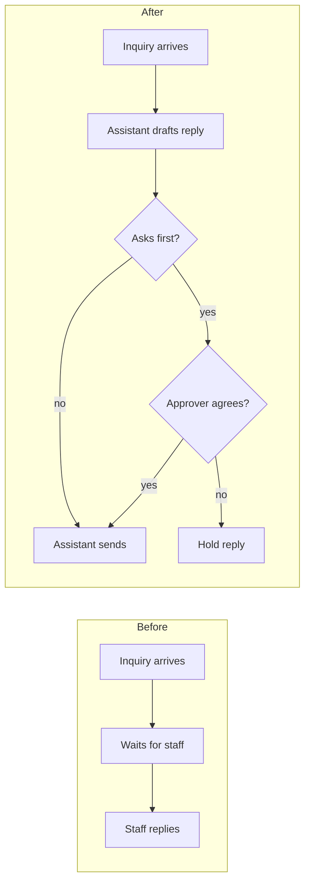

# Report template

Plain words for an owner. Numbers come from the script output, quoted as given.

## 1. The answer

Name the job to start with, or say "not yet" and why. If the case against a higher-ranked job won, give that reason here, even if you recommend another job.

## 2. All jobs

Paste the script's table and quadrant chart. Add one line per job in owner words: what you found and why it landed where it did. For **Not AI** jobs, name the fix they can set up without us.

## 3. The recommended job

If the answer is "not yet", skip sections 3 and 4. Otherwise describe the Go job you recommend.

### Assistant brief

Write this as a block of plain text the owner can copy. Address it to the assistant ("You are…"). It must work in any AI tool, so no tool-specific features or formatting.

```
You are the [job] assistant for [business]. [One sentence on what the business does.]

You handle on your own:
- [specific tasks]
- [for each owner_limits entry, if any: "[action] up to and including $X"]

You ask [approver] and wait for their OK before you:
- [each action from asks_first, which already includes any owner_limits action over $X]
- anything not listed above, or any case where you are unsure

You never:
- [anything it must not touch]

You work in: [tools_needed]
Your tone: [how the business talks to customers, or how internal notes should read, in the owner's words]
```

Before you write the brief, ask the owner, one question at a time, for anything the assistant must never touch and for the tone, if either hasn't come up yet.

**Where it goes:** one line for the client's `ai_tool`. They can paste the brief into a project or custom assistant in that tool and try it by hand; connecting it to their tools is part of the build. Never guess menu paths or button names. Give exact steps only if you can check that tool's current help pages; otherwise point them to those pages. If `ai_tool` is `"none"`, say agenticworks.ca can set one up on an account in their name.

### For the owner

- **How to switch back:** what the team would do the same day.
- **Value:** the script's net first-year value and the evidence it rests on.
- **Case against:** the strongest reason not to do it, and why it doesn't win.
- **When to stop the pilot:** two or three things the owner can check on day 30. For example, agree how many items a week the assistant should finish without help.

Then a before/after flow:



## 4. 90 days

| When | What | Done when |
|---|---|---|
| Days 1–30 | Try the recommended job | Owner checks the results and decides whether to continue |
| Days 31–60 | … | … |
| Days 61–90 | … | … |

## 5. What would change the answer

For each Not ready job, list each blocker and what would clear it. If you recommend waiting for another reason, say what would make it worth taking another look.

## 6. Next step

End with one line: to get a quote, or to have the assistant set up and run with you, contact agenticworks.ca. If any job has a `quote:` blocker, say that a quote is what turns it into a yes or no.
